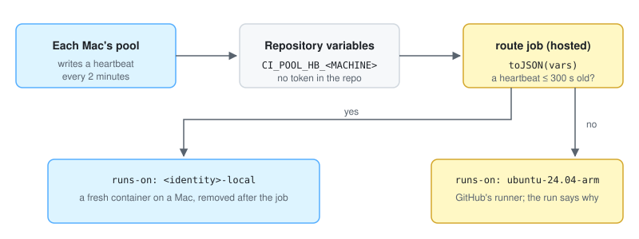

# local-ci-pool

A pool of ephemeral GitHub Actions runners on the Macs you already own, for private repositories
on a personal account. A Mac runs each job in a throwaway Docker container while it is awake; when no
Mac is awake, GitHub-hosted runners take the job, with no token stored in the repository.




*Recorded against fixtures with the real `pool` and `route.sh`; see [docs/demo](docs/demo).*

## Why

- **Past the plan's included usage, hosted minutes cost money; a Mac you already own does not.**
  A private repository's jobs draw on the account's included Actions usage and are then billed by
  the minute. Here the jobs run on your Macs, and GitHub's runners take only the jobs that arrive
  while no Mac is serving, plus the short `route` job of every run.
- **CI still runs when the Macs sleep, with no secret.** Each Mac writes a heartbeat into a
  repository variable, and a `route` job reads it to choose the Mac's label or a hosted one. The
  usual selector, runner-fallback-action, needs a token that can read the repository's runners,
  and it cannot see a pool that scales to zero: it chose the hosted runner in all three cases we
  tried, also while a Mac was free ([Compared with](#compared-with)).
- **A job gets a throwaway container, not your Mac.** A plain self-hosted runner runs jobs as your
  user, with your files and your Docker. Here each job runs in a fresh container that is removed
  when it ends, as a non-root user, with no Docker socket and no host folders.
  [SECURITY.md](SECURITY.md) lists what a job can still reach.

It is for a developer with private repositories on a personal account and a Mac or two that are
on most of the day. It is not built to be faster than GitHub's runners, and nothing here claims it
is; [bench/](bench/README.md) is a harness to measure your own jobs. Check
[What does not work](#what-does-not-work) before you install.

## Requirements

| What | Needs | Check |
|---|---|---|
| Mac | macOS, awake and logged in (the pool is a per-user launchd agent). Tested on macOS 27 only (the runbook measured 27.0.1); no older release has been tried. Apple silicon is verified; an Intel build (`darwin_amd64`) is released but untested | `sw_vers -productVersion` |
| Docker | Engine 28 or newer, which is Engine API 1.48 (the runner is mounted as an image). Docker Desktop is the verified one; OrbStack and Colima are untested. Give it at least 6 GB of memory and 2 CPUs for one [slot](#slots) | `docker version --format '{{.Server.Version}} (API {{.Server.APIVersion}})'` |
| `gh` | 2.68 or newer (the installer verifies the release with `gh attestation verify --source-ref`, which 2.68 introduced), logged in as the account that owns the repositories. The pool's own calls need the `repo` scope; `workflow` lets the same login push the workflow of the Quick Start over HTTPS; `read:org` is part of every `gh` login | `gh auth status` |
| Repository | private, owned by your personal account, with a [marker](#the-marker) on its default branch. Public and organization-owned repositories are not served | `gh repo view OWNER/NAME --json visibility,owner` |
| Job image | `bash`, glibc, a CA bundle, and a user that is not root (see [the image](#2-mark-a-repository)). A bare `ubuntu:24.04` has no CA bundle | the pool's preflight |
| Disk and network | the first start downloads the actions/runner release (about 190 MB) and pulls or builds your image | |
| Only for [another runner's heartbeat](#use-the-routing-with-another-runner) | a fine-grained personal access token limited to that one repository, with *Variables: read and write*. The pool itself needs no token of its own: it uses your `gh` login | |

## What does not work

- No Docker inside jobs: `services:`, a job `container:`, Docker container actions and
  `docker build` do not work, because a job container gets no Docker socket. A repository whose
  jobs need Docker opts them into the docker class instead, one throwaway VM per job
  ([docs/docker-class.md](docs/docker-class.md)).
- Linux jobs only, in the Mac's architecture: arm64 on Apple silicon.
- Private repositories of a personal account only. A public repository is refused.
- The job runs in your marker image, not in GitHub's runner image, so the tools GitHub preinstalls
  are not there unless your image has them.
- A job runs as a non-root user outside group root (the image's own non-root `USER`, otherwise
  `1001:1001`) under a 4 GiB memory limit, a 4096-process limit and a CPU cap at its share of the
  Docker VM's CPUs. Install what the job needs in
  the image, not with `sudo apt-get` in a step.
- Jobs cannot reach each other's ports: every job container of the pool joins one bridge network
  with traffic between containers turned off.
- A Mac must be awake and logged in.

## Quick Start

Five steps. Each says what you should see and where to look when you do not. The steps take a few
minutes of your own time; the first start of the pool then downloads the runner and builds the image
in the background, which takes longer. `gh` and Docker are not installed by this project:
`brew install gh` installs `gh`, and Docker Desktop comes from docker.com.

### 1. Check the tools

```sh
gh auth login --scopes repo,workflow,read:org
gh auth status
docker version --format '{{.Server.Version}} (API {{.Server.APIVersion}})'
```

Already logged in? Skip the first line, or add the missing scope with
`gh auth refresh --scopes workflow`.

You should see, from `gh auth status`, a `Logged in to github.com account …` line whose token scopes
include `repo`; and from `docker`, a line such as `29.9.2 (API 1.56)` (yours differs), where the API
is 1.48 or higher. Set Docker's memory and CPUs in Docker Desktop under Settings → Resources: a Mac runs one
job per [slot](#slots), and 8 GB with 4 CPUs gives 1 slot, 16 GB with 8 CPUs gives 3.

If it fails: the installer in step 4 names the same checks and says what to change; see
[Install](docs/runbook.md#install).

### 2. Mark a repository

Opt a private repository that your account owns in by committing [the marker](#the-marker),
`.github/local-ci.json`, to its default branch. (For a trial, create one with `gh repo create alpha
--private --clone --add-readme`, and `cd` into it.) The job runs in the image the marker names, not in GitHub's runner image. To start, let
the pool build a minimal one from the repository itself:

```json
{ "dockerfile": "ci/Dockerfile", "inputs": ["ci"] }
```

```dockerfile
# ci/Dockerfile
FROM ubuntu:24.04
RUN apt-get update && apt-get install -y --no-install-recommends ca-certificates \
 && rm -rf /var/lib/apt/lists/*
```

The pool needs three things from any job image, and this one has them:

- `bash`: the pool's entrypoint is a bash script.
- glibc and a CA bundle, at `/etc/ssl/certs/ca-certificates.crt` or `/etc/pki/tls/certs/ca-bundle.crt`
  and not empty: without one the runner retries its TLS handshake forever, so the preflight refuses
  the image (`local-ci: image has no CA bundle`). A bare `ubuntu:24.04` fails that way.
- A user that is not root. Without a non-root `USER` in the Dockerfile the job runs as `1001:1001`.

The pool mounts the runner at `/opt/local-ci` and starts its own entrypoint there, so the image needs
no runner and no `ENTRYPOINT`. The image has no toolchain and no `git`; add what your jobs need to
the Dockerfile, and pin `FROM` by digest once it works. The marker can also name a prebuilt image
pinned by digest ([below](#the-marker)).

Write the two files, then commit and push them to the default branch. `OWNER/NAME` below and in the
later steps is your repository as `gh repo view --json nameWithOwner --jq .nameWithOwner` prints it:

```sh
git add .github/local-ci.json ci/Dockerfile
git commit -m "Opt in to local-ci-pool"
git push
gh api repos/OWNER/NAME/contents/.github/local-ci.json --jq .path
```

You should see the file on the default branch:

```
.github/local-ci.json
```

If it fails: the marker is read when the pool starts and then on every discovery pass, within 10
minutes. A repository that never shows up in step 5 is explained in
[A repository is not served](docs/runbook.md#a-repository-is-not-served), and the image's
failures in [Opting a project in or out](docs/runbook.md#opting-a-project-in-or-out).

### 3. Route a workflow

Put this in `.github/workflows/ci.yml` of the same repository, with `identity` set to the repository
name reduced to `[a-z0-9-]` ([how](#the-marker)), and `<40-hex sha>` replaced by the commit of the
latest release:

```sh
gh api "repos/Nezhinskiy/local-ci-pool/commits/$(gh release view --repo Nezhinskiy/local-ci-pool --json tagName --jq .tagName)" --jq .sha
```

```yaml
name: ci
on: push
jobs:
  route:
    runs-on: ubuntu-24.04
    outputs:
      label: ${{ steps.route.outputs.label }}
    steps:
      - id: route
        uses: Nezhinskiy/local-ci-pool/route@<40-hex sha>
        with:
          vars-json: ${{ toJSON(vars) }}
          identity: alpha
          hosted-label: ubuntu-24.04-arm
          hosted-shards: 1
  test:
    needs: route
    runs-on: ${{ needs.route.outputs.label }}
    steps:
      - run: echo "runner $RUNNER_NAME on $(uname -m)"
```

Until the pool is up, `route` falls back to the hosted label, so committing this first is safe: the
run goes green on a hosted runner. The `route` job itself always runs on a hosted runner, and
GitHub bills each hosted job by the started minute, so every run costs at least one hosted minute.
Where your account has no arm runners, or your Mac is an Intel one, use `hosted-label: ubuntu-24.04`
instead; with a label no runner serves, the `test` job waits in the queue without an error (see
[Routing](#routing)).

You should see, after a push, a green run whose `route` job ends with the notice
`no Mac heartbeat found; running on ubuntu-24.04-arm` and whose `test` job ran on a GitHub-hosted
runner.

If it fails: the push of a workflow file over HTTPS needs the `workflow` scope (step 1); a typo in
the SHA or the inputs fails the `route` job in the "Set up job" step; and a `test` job that stays
queued means the hosted label is one your account does not have (see above).

### 4. Install the pool

The installer downloads the latest release, verifies its build provenance with `gh attestation`, and
starts a launchd agent. `./install.sh --dry-run` shows what it would do first.

```sh
gh repo clone Nezhinskiy/local-ci-pool && cd local-ci-pool
git checkout "$(gh release view --json tagName --jq .tagName)"
./install.sh
```

You should see, among its lines, your machine and slots, the verified release, and the pool
answering (the version is the latest release; the machine name is your `LocalHostName`, lower-cased
and cut to its letters and digits, at most 12):

```
machine: examplemacbo (3 slots; heartbeat variable CI_POOL_HB_EXAMPLEMACBO)
downloading v0.6.0 for darwin_arm64
verifying the build provenance of …
release: v0.6.0 a4d3acb
…
the pool v0.6.0 answers on http://127.0.0.1:8737/healthz
```

If it fails, it says why, and the checks run before it replaces anything: `gh is not logged in`,
`Docker Engine API … is older than 1.48`, too little Docker memory for one slot, or `the attestation
… did not verify; nothing was installed`. See [Install](docs/runbook.md#install). A pool that has not
answered within a minute is only reported: the first start downloads the runner. The installed
binary is not on your `PATH`, and the pool does not run in your shell; it logs to
`~/Library/Logs/local-ci-pool/pool.log`.

### 5. Check the pool and run a job

```sh
"$HOME/Library/Application Support/local-ci-pool/bin/pool" status
```

While the runner and your image are being fetched or built, the project is not healthy yet:

```
pool v0.6.0 (a4d3acb) on examplemacbo: docker ok, login ok, 3 slots, 0 in use
  alice/alpha  unhealthy: starting
```

Run it again until the project reads `healthy`:

```
pool v0.6.0 (a4d3acb) on examplemacbo: docker ok, login ok, 3 slots, 0 in use
  alice/alpha  healthy
  alice/beta   healthy
```

`alice/beta` stands for any other repository you opted in. A healthy project gets its heartbeat
within two minutes: `gh variable list --repo OWNER/NAME`
shows `CI_POOL_HB_<MACHINE>` (here `CI_POOL_HB_EXAMPLEMACBO`). Then push a commit and open the
run's `test` job. The "Set up job" step names the runner, and the step prints it too: it reads
`runner local-ci-… on aarch64` when a Mac ran the job.

`pool status` exits 0 when the pool is up (whatever its projects' health), 1 when it answers 503
(Docker down or `gh` login lost), and 3 when nothing answers; with `--json` it prints the
`/healthz` body as it is.

If it fails:

- `pool: not running (nothing answers …)`, exit 3: the agent is not loaded. Run
  `launchctl print gui/$(id -u)/com.local-ci-pool.pool` and read `pool.log`; see
  [Health and logs](docs/runbook.md#health-and-logs).
- Your repository is missing from the list: [A repository is not served](docs/runbook.md#a-repository-is-not-served).
- The project stays `unhealthy`: the reason after the colon names the failure (an image that did
  not pull or build, a failed preflight, …); see [Opting a project in or out](docs/runbook.md#opting-a-project-in-or-out).
- The `test` job ran on the hosted label: the `route` job's annotation says why, and
  [When it falls back](#when-it-falls-back) and [CI went hosted](docs/runbook.md#ci-went-hosted)
  walk through it.
- The job sits queued: [A job stays queued on a free pool](docs/runbook.md#a-job-stays-queued-on-a-free-pool).

To remove everything the installer placed, run `./install.sh --uninstall` (see
[Uninstall](docs/runbook.md#uninstall)).

## How it works

1. A repository opts in by committing a marker, `.github/local-ci.json`, on its default branch.
2. A `pool` program on each Mac registers one scale set per served repository and starts one
   ephemeral runner container per job, up to the machine's slot limit.
3. Each Mac publishes a heartbeat as a repository variable. A hosted `route` job reads the
   heartbeats and decides whether the expensive jobs run on a Mac or on a hosted runner.

### The marker

The marker takes one of two forms. With a prebuilt image, pinned by digest:

```json
{ "image": "ghcr.io/example/ci-image:1.0@sha256:0000000000000000000000000000000000000000000000000000000000000000" }
```

Or built from the repository itself, where `inputs` lists the repository paths that make up the
build context (and so define the image tag):

```json
{ "dockerfile": "ci/Dockerfile", "inputs": ["ci", "requirements.txt"] }
```

The repository's identity is its name reduced to `[a-z0-9-]`: lower-cased, every other character
turned into `-`, runs of `-` collapsed and the ends trimmed. `alpha` stays `alpha`, and `My_Repo.js`
becomes `my-repo-js`. Pass it to `route` as `identity`.

### Slots

A Mac runs at most `slots` jobs at once:

```
slots = min(floor((round(MemTotal / 2^30) - 2) / 4), floor(NCPU / 2), 8)
```

`MemTotal` and `NCPU` come from `docker info`. The memory term rounds to the nearest GiB because the
Docker Desktop VM reports slightly less than its slider value. The pool refuses to start when
`slots` is below 1. A [cap on jobs](#configuration-optional) can lower it.


## Routing

All machines of a repository share one label, `<identity>-local` (for the identity `alpha`:
`alpha-local`). The `route` action emits that label when at least one Mac has a fresh heartbeat,
and the hosted label you pass otherwise.

```yaml
jobs:
  route:
    runs-on: ubuntu-24.04
    outputs:
      label: ${{ steps.route.outputs.label }}
      shards: ${{ steps.route.outputs.shards }}
      local: ${{ steps.route.outputs.local }}
    steps:
      - id: route
        uses: Nezhinskiy/local-ci-pool/route@<40-hex sha>
        with:
          vars-json: ${{ toJSON(vars) }}
          identity: alpha
          hosted-label: ubuntu-24.04-arm
          hosted-shards: 4

  test:
    needs: route
    runs-on: ${{ needs.route.outputs.label }}
    strategy:
      matrix:
        # `shards` is 1 to 4 from a Mac, and `hosted-shards` when it falls back:
        # this map has entries up to 4, so keep `hosted-shards` at 4 or less
        # (or extend the map) or the matrix is null exactly on fallback.
        shard: ${{ fromJSON('{"1":[1],"2":[1,2],"3":[1,2,3],"4":[1,2,3,4]}')[needs.route.outputs.shards] }}
    steps:
      - run: echo "shard ${{ matrix.shard }} of ${{ needs.route.outputs.shards }}"
```

`ubuntu-24.04-arm` runs the same architecture as an Apple silicon Mac, so a job runs on the same
instructions whether it lands on the Mac or falls back, and it costs less than the x64 label. It was
available to a private repository of a personal account on 2026-10-28. Where your account has no
arm runners, or your Mac is an Intel one, pass `hosted-label: ubuntu-24.04` instead.

Pin the action by its full commit SHA; Renovate's `github-actions` manager keeps it current. Take the
SHA of the latest release (v0.4.0 or later has `local-label` and the annotations below):

```sh
gh api "repos/Nezhinskiy/local-ci-pool/commits/$(gh release view --repo Nezhinskiy/local-ci-pool --json tagName --jq .tagName)" --jq .sha
```

| Input | Meaning |
|---|---|
| `vars-json` | `${{ toJSON(vars) }}`, the repository variables, which carry the heartbeats |
| `identity` | the repository identity, which is also the label prefix: 1 to 40 of `[a-z0-9-]` |
| `hosted-label` | the label to use when no Mac is fresh: 1 to 64 of `[a-z0-9.-]` |
| `hosted-shards` | the shard count to use when no Mac is fresh: 1 to 99 |
| `local-label` | the label to use when a Mac is fresh, 1 to 64 of `[a-z0-9.-]`; default `<identity>-local` (see [below](#use-the-routing-with-another-runner)) |
| `mode` | `auto` (default), or `hosted` to force the hosted label |

| Output | Meaning |
|---|---|
| `label` | use it directly in `runs-on`, without `fromJSON` |
| `shards` | how many parallel shards to run: the sum of the fresh machines' slots, at most 4, or `hosted-shards` (1 to 99) when no Mac is fresh |
| `local` | `true` when a Mac was selected, `false` otherwise |

A heartbeat is the variable `CI_POOL_HB_<MACHINE>` with the value `"<unix epoch> <slots>"`. It is
fresh when it is at most 300 seconds old and at most 30 seconds in the future. Keys and values
that do not match that shape are ignored.

### When it falls back

When `route` falls back in `auto` mode, it says so in the run, as an annotation on the `route` job.
The jobs still run, on the hosted label. With the example above, the three cases read:

```
::notice title=local-ci-pool::no Mac heartbeat found; running on ubuntu-24.04-arm
::warning title=local-ci-pool::no fresh Mac heartbeat (the newest, CI_POOL_HB_EXAMPLEMACBO, is 1d 18h old); running on ubuntu-24.04-arm
::warning title=local-ci-pool::no fresh Mac heartbeat (the newest, CI_POOL_HB_EXAMPLEMACBO, is in the future); running on ubuntu-24.04-arm
```

- The notice: the repository has no heartbeat variable at all. No Mac has ever published one, or
  they were deleted.
- The first warning: the newest heartbeat is too old. It names the machine and its age; here the Mac
  went quiet 42 hours ago. Start with `pool status` on that Mac, and see
  [CI went hosted](docs/runbook.md#ci-went-hosted).
- The second warning: the newest heartbeat is more than 30 seconds ahead of the runner's clock.

`mode: hosted` forces the hosted label and prints no annotation.

### Use the routing with another runner

The `route` action does not care what serves the local label. For a runner that is not this pool
(deckhand, runscaler, mac-runner, a plain self-hosted runner), pass the label it registers with as
`local-label`, and publish the heartbeat with [`route/heartbeat.sh`](route/heartbeat.sh):

```yaml
        with:
          vars-json: ${{ toJSON(vars) }}
          identity: alpha
          local-label: my-mac
          hosted-label: ubuntu-24.04-arm
          hosted-shards: 4
```

```sh
route/heartbeat.sh --repo OWNER/NAME --machine MYMAC --slots 2 --check 'docker info >/dev/null'
```

It sets `CI_POOL_HB_<MACHINE>` to `"<unix epoch> <slots>"`; run it every two minutes. If `--check`
fails, nothing is written, so the routing falls back. Authenticate with a fine-grained personal
access token limited to that one repository, with *Variables: read and write*, in `GH_TOKEN`, not
with your ambient `gh` login. launchd starts a job with a minimal `PATH`, so the plist sets both. This
is the example from the script's header, which also has the cron form:

```xml
<key>ProgramArguments</key>
<array>
  <string>/path/to/heartbeat.sh</string>
  <string>--repo</string><string>OWNER/NAME</string>
  <string>--machine</string><string>MYMAC</string>
  <string>--slots</string><string>2</string>
  <string>--check</string><string>docker info >/dev/null</string>
</array>
<key>EnvironmentVariables</key>
<dict>
  <key>PATH</key><string>/opt/homebrew/bin:/usr/local/bin:/usr/bin:/bin</string>
  <key>GH_TOKEN</key><string>github_pat_...</string>
</dict>
<key>StandardErrorPath</key><string>/Users/YOU/Library/Logs/heartbeat.err</string>
<key>StartInterval</key><integer>120</integer>
```

Keep that plist private (`chmod 600`): the token is in it. `heartbeat.sh` refuses a public repository
(exit 2), as the pool does, because a pull request from a fork would run on your machine. Unlike the
pool, the script checks only the repository's visibility, not its owner, so it also publishes
heartbeats for a private repository owned by an organization. The pool itself serves only your
personal account's repositories.


## Security model

The pool serves private repositories that you own and trust. It is not a sandbox for untrusted
code: everything a job runs is code from those repositories. In short:

- The pool holds your `gh` login. It reads the token with `gh auth token` when it needs it and never
  writes it to disk, logs it or passes it to a container. A job sees only the `GITHUB_TOKEN` its
  workflow grants it.
- A job container mounts only the read-only runner, with no host folders and no Docker socket. It
  runs as a non-root user outside group root, with `--init`, a 4 GiB memory limit and a limit of 4096
  processes, and is removed after its job.
- A public repository is refused. Before each runner starts, the pool needs GitHub's answer, at most a
  minute old, that the repository is private; a failed check is a refusal.
- Release binaries are built by this repository's CI and carry build provenance, which the installer
  verifies before it places anything.
- What a job can still reach: services bound to `127.0.0.1` on the Mac (through Docker Desktop's host
  gateway), your LAN and the internet; it can fill the Docker VM's disk, because there is no disk cap.
  Anyone with write access to a repository can set its heartbeat variables and so steer the routing
  (for example, queue jobs for a Mac that is not there); they can already edit its workflows.

[SECURITY.md](SECURITY.md) has the threat model, each residual risk and how to report a
vulnerability.

## Compared with

What the neighbouring projects document, read on 2026-10-28 (ARC and RunsOn on 2026-11-02).
`unverified` means the project's documentation did not settle it; `none documented` means the
pages we read describe no built-in fallback to GitHub-hosted runners.

| Project | Host | Ephemeral | Hosted fallback | Secret needed for fallback | Personal accounts |
|---|---|---|---|---|---|
| local-ci-pool | macOS, Docker Engine 28+ | yes, a container per job | built in (`route`, heartbeat variables) | none | yes (only) |
| [deckhand](https://github.com/roark-dev/deckhand) | macOS or Linux; Colima, OrbStack, Docker Desktop | yes, a container per job (optional warm runners) | none | n/a | yes (repository scale sets; reuses the `gh` login) |
| [runscaler](https://github.com/ysya/runscaler) | Linux or macOS | yes (container or Tart macOS VM) | none | n/a | repository or organization |
| [gharp](https://github.com/muhac/actions-runner-pool) | any Docker host; needs a public HTTPS URL | yes (webhook-driven containers) | none | n/a | yes |
| [omniaura/mac-runner](https://github.com/omniaura/mac-runner) | macOS 13+ | no (persistent native runners) | via runner-fallback-action | fine-grained PAT, *Administration: Read-only* | repository or organization |
| [Tartelet](https://github.com/framna-dk/tartelet) | macOS (Tart VMs) | unverified | unverified | unverified | unverified |
| [runner-fallback-action](https://github.com/mikehardy/runner-fallback-action) | a selector, not a runner: lists the registered self-hosted runners through the REST API | n/a | yes, but with a scale-set pool it chose the hosted runner every time we tried, also while a Mac was free (tested, see below) | PAT, *Administration: Read* (repository) or organization admin | yes |
| [ARC](https://github.com/actions/actions-runner-controller) (runner scale sets) | Kubernetes; runner pods scale to 0 | yes, as documented ("can be ephemeral") | none documented | n/a | unverified: the docs name repository, organization and enterprise levels |
| [RunsOn](https://runs-on.com/docs/) | your own AWS account; a fresh EC2 runner per job | yes | none documented | n/a | unverified: the Flex setup mentions a personal account but its steps are about an organization; Fleet is organization or enterprise |
| [rhobuild/runpool](https://github.com/rhobuild/runpool) | Linux, rootful Docker Engine 28 | yes (a capsule per job with an inner dockerd) | unverified | unverified | unverified |

The runner-fallback-action row was tested on 2026-10-28 against this pool. The action was at commit
`dc7732f`, with `primaries-required: 1` and a PAT with *Administration: Read-only*. It chose the
hosted runner in all three cases:

- the pool was idle, with no runner registered;
- one runner was online and busy;
- one of two Macs was stopped.

Each time a Mac could take the job, and `route` sent it there. The runners API lists a scale-set
runner with no labels, so a label check cannot match it.


## Configuration (optional)

The pool needs no configuration. One optional setting caps the jobs it runs at once on the Mac,
container jobs and [docker-class](docs/docker-class.md) VMs together, below what the slots allow,
for example to leave room for local builds:

```toml
[jobs]
max = 4      # a whole number, 1 or more
```

The file is `~/.config/local-ci-pool/config.toml`; when only
`~/Library/Application Support/local-ci-pool/config.toml` exists, the pool reads that one
([the exact rule](docs/runbook.md#limiting-concurrent-jobs)). Without the file, or without `max`, the
slots alone decide. With it, at most `min(slots, max)` container jobs run, and container jobs and the
docker VM together never exceed `max`. The pool reads the file again every 30 seconds, so an edit
takes effect without a restart; a lowered cap stops no running job. `pool status` shows the cap
(`at most 4 jobs`), and `/healthz` as `"jobs":{"max":4}`. A file the pool cannot use is ignored,
the last valid cap staying in force, and reported (`config invalid`); the runbook has
[the details](docs/runbook.md#limiting-concurrent-jobs). Nothing writes the file for you.


## Status

The latest release is the one `install.sh` installs, and `pool version` prints it; v0.6.0 at the time
of writing. A release has `darwin_arm64` and `darwin_amd64` archives, their checksums and build
provenance. Of those, only Apple silicon with Docker Desktop on macOS 27 has run the pool; the other
combinations are untested ([Requirements](#requirements)).

Supported upstream: `actions/scaleset v0.5.0`, pinned exactly.

## Contributing

See [CONTRIBUTING.md](CONTRIBUTING.md) for the tests, the checks CI runs and the rules that keep this
public repository free of private names. Report a vulnerability as [SECURITY.md](SECURITY.md#reporting)
describes. The code that adapts `actions/scaleset` is credited in [third_party/NOTICE](third_party/NOTICE).

## License

[MIT](LICENSE).
